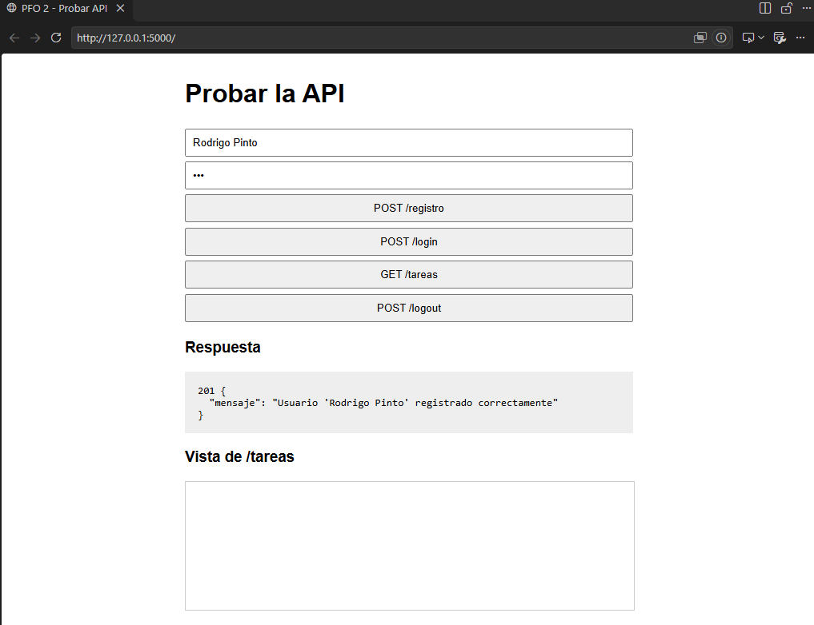
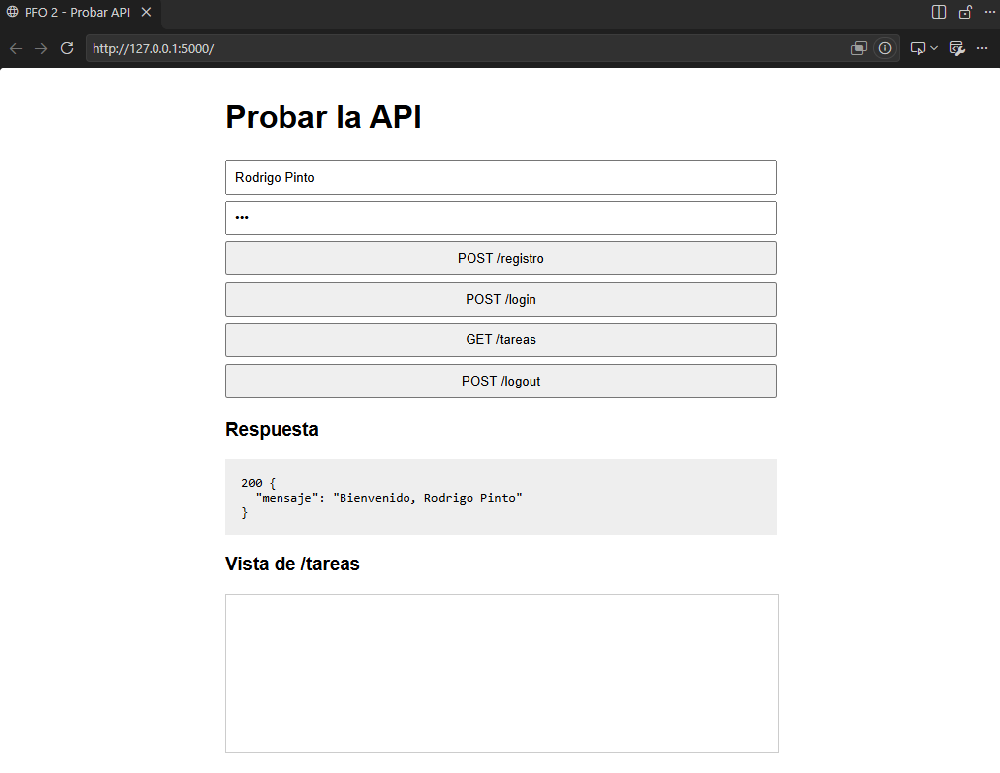
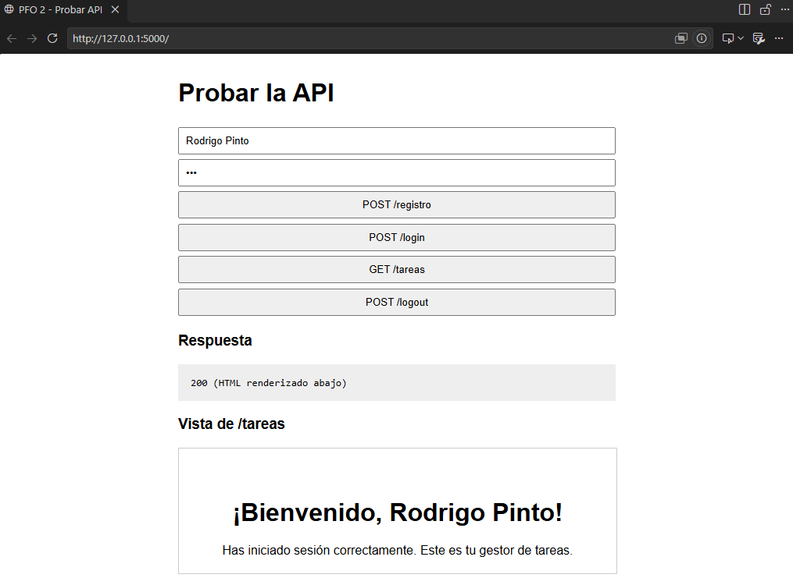
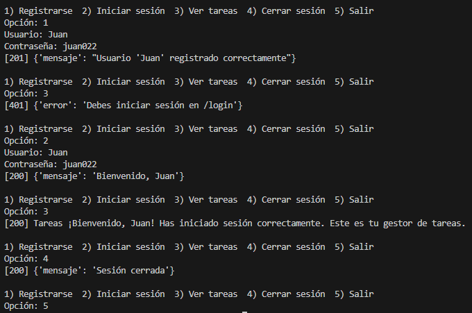

# Sistema de Gestión de Tareas — API REST con Flask y SQLite

**PFO 2 · Redes** — API REST con registro de usuarios, autenticación con contraseñas hasheadas y persistencia en SQLite, acompañada de un cliente de consola y desplegada como servicio web.

| | |
|---|---|
| **Autor** | Rodrigo Pinto |
| **Repositorio** | https://github.com/rodgpinto/PFO-2-ProgramacionSobreRedes |
| **Servicio desplegado** | _URL de Render_ (la raíz `/` ofrece una interfaz web para probar la API) |

## Objetivos

1. Implementar una API REST con endpoints funcionales.
2. Utilizar autenticación básica con protección de contraseñas.
3. Gestionar datos persistentes con SQLite.
4. Construir un cliente en consola que interactúe con la API.

## Tecnologías

| Componente | Tecnología | Motivo |
|---|---|---|
| Servidor web | Flask | Framework liviano, adecuado para una API pequeña |
| Hash de contraseñas | `werkzeug.security` | Hash con *salt* aleatorio y algoritmo lento, incluido con Flask |
| Base de datos | SQLite (`sqlite3`) | Sin servidor, incluida en Python, persistente en archivo |
| Cliente | `requests` | Manejo de sesión y cookies simple |
| Servidor de producción | Gunicorn | Servidor WSGI para el despliegue |
| Hosting | Render | Ejecuta procesos Python persistentes (ver [Despliegue](#despliegue)) |

## Estructura del proyecto

```
.
├── servidor.py        # API Flask + acceso a SQLite
├── cliente.py         # Cliente de consola
├── requirements.txt   # Dependencias
├── render.yaml        # Configuración de despliegue (Render)
└── README.md
```

## Arquitectura

```
 Cliente de consola ─┐                          ┌───────────────┐
 (cliente.py)        ├── HTTP/JSON + cookie ──► │  Flask API    │ ──► SQLite
 Navegador (GET /)  ─┘                          │ (servidor.py) │     usuarios.db
                                                └───────────────┘
```

El login crea una sesión firmada (cookie) que el servidor valida en las rutas protegidas.

### Modelo de datos

Tabla `usuarios`:

| Campo | Tipo | Restricciones |
|---|---|---|
| `id` | INTEGER | Clave primaria, autoincremental |
| `usuario` | TEXT | `NOT NULL`, `UNIQUE` |
| `password_hash` | TEXT | `NOT NULL` — nunca se guarda la contraseña en texto plano |

## Documentación de la API

### `GET /`
Página HTML con formularios para probar los endpoints desde el navegador.

### `POST /registro`
Crea un usuario.

Solicitud:
```json
{"usuario": "ana", "contraseña": "1234"}
```

| Código | Significado | Cuerpo |
|---|---|---|
| 201 | Usuario creado | `{"mensaje": "Usuario 'ana' registrado correctamente"}` |
| 400 | Faltan campos | `{"error": "Faltan 'usuario' o 'contraseña'"}` |
| 409 | Usuario existente | `{"error": "El usuario ya existe"}` |

### `POST /login`
Verifica credenciales e inicia sesión (establece la cookie de sesión).

Solicitud: igual a `/registro`.

| Código | Significado | Cuerpo |
|---|---|---|
| 200 | Credenciales válidas | `{"mensaje": "Bienvenido, ana"}` |
| 401 | Credenciales inválidas | `{"error": "Credenciales inválidas"}` |

### `GET /tareas`
Devuelve una página HTML de bienvenida al usuario autenticado.

| Código | Significado |
|---|---|
| 200 | HTML de bienvenida |
| 401 | `{"error": "Debes iniciar sesión en /login"}` |

### `POST /logout`
Cierra la sesión actual (elimina la cookie de sesión).

| Código | Significado | Cuerpo |
|---|---|---|
| 200 | Sesión cerrada | `{"mensaje": "Sesión cerrada"}` |

> **Nota sobre la sesión:** la autenticación se mantiene mediante una cookie del navegador, por lo que recargar la página conserva al usuario autenticado. `POST /registro` solo crea la cuenta y no inicia sesión; para cambiar de usuario se debe ejecutar `POST /login` con las nuevas credenciales (que reemplaza la sesión anterior) o `POST /logout`.

## Seguridad

- **Contraseñas hasheadas** con `generate_password_hash` y verificadas con `check_password_hash`; no existe ningún punto donde se almacene o registre la contraseña en claro.
- **Consultas parametrizadas** (`?`) en todas las operaciones SQL, lo que previene inyección SQL.
- **Mensaje de error genérico** en el login: no se distingue entre usuario inexistente y contraseña incorrecta, para no revelar qué usuarios existen.
- **Escape de HTML** automático en la vista de bienvenida (Jinja2), que evita inyección de código a través del nombre de usuario.
- **Clave de sesión** (`SECRET_KEY`) tomada de una variable de entorno en producción.

## Ejecución local

Requisitos: Python 3.9 o superior.

```bash
python -m venv .venv
.venv\Scripts\activate            # Windows  (Linux/macOS: source .venv/bin/activate)
pip install -r requirements.txt
python servidor.py
```

El servidor queda disponible en `http://127.0.0.1:5000`. En otra terminal, con el entorno activado:

```bash
python cliente.py
```

### Variables de entorno

| Variable | Uso | Valor por defecto |
|---|---|---|
| `SECRET_KEY` | Firma de la cookie de sesión | Clave de desarrollo (cambiar en producción) |
| `DB_PATH` | Ruta del archivo SQLite | `usuarios.db` junto a `servidor.py` |
| `API_URL` | (cliente) URL base de la API | `http://127.0.0.1:5000` |

## Pruebas

### Desde el navegador
Abrir la raíz `/` y usar los botones **POST /registro**, **POST /login**, **GET /tareas** (muestra el HTML renderizado) y **POST /logout**.

### Con curl
```bash
curl -X POST <URL>/registro -H "Content-Type: application/json" \
     -d '{"usuario":"ana","contraseña":"1234"}'

curl -c cookies.txt -X POST <URL>/login -H "Content-Type: application/json" \
     -d '{"usuario":"ana","contraseña":"1234"}'

curl -b cookies.txt <URL>/tareas
```

### Con el cliente de consola
```bash
python cliente.py                                   # contra el servidor local
API_URL=<URL> python cliente.py                     # contra el servicio desplegado
```

### Casos verificados

| # | Caso | Resultado esperado | Resultado |
|---|---|---|---|
| 1 | Registrar usuario nuevo | 201 | ✅ |
| 2 | Registrar usuario repetido | 409 | ✅ |
| 3 | Registrar sin contraseña | 400 | ✅ |
| 4 | Login con contraseña incorrecta | 401 | ✅ |
| 5 | Login correcto | 200 + cookie de sesión | ✅ |
| 6 | `GET /tareas` sin sesión | 401 | ✅ |
| 7 | `GET /tareas` con sesión | 200 + HTML de bienvenida | ✅ |
| 8 | Login con otro usuario | La sesión pasa al nuevo usuario | ✅ |
| 9 | `POST /logout` y luego `GET /tareas` | 401 | ✅ |

### Capturas de pantalla

Las capturas de las pruebas exitosas se encuentran en la carpeta [`capturas/`](capturas/):







## Despliegue

El servicio está desplegado en **Render** como *Web Service* con Gunicorn (`render.yaml`):

- Build: `pip install -r requirements.txt`
- Start: `gunicorn servidor:app`
- `SECRET_KEY` generada automáticamente por la plataforma.

### Decisión de plataforma

| Opción | ¿Sirve para este proyecto? | Motivo |
|---|---|---|
| **GitHub Pages** | No | Aloja solo contenido estático; no ejecuta Python, no atiende `POST` ni accede a bases de datos. |
| **Vercel** | No | Ejecuta funciones *serverless* efímeras con sistema de archivos de solo lectura (salvo `/tmp`, que se pierde). Un archivo SQLite no persistiría entre peticiones; obligaría a usar una base externa y abandonar SQLite. |
| **Render** | **Sí** | Mantiene un proceso Python en ejecución, con disco de escritura (SQLite funciona sin cambios), HTTPS y despliegue automático desde GitHub. |

### Limitaciones conocidas

- En el plan gratuito de Render el disco es **efímero**: `usuarios.db` se reinicia con cada nuevo despliegue o reinicio del servicio.
- El servicio se suspende tras unos 15 minutos sin tráfico; la primera petición posterior demora unos segundos.
- Para persistencia real: adjuntar un *Persistent Disk* (plan de pago) montado en `/var/data` y definir `DB_PATH=/var/data/usuarios.db`, o migrar a PostgreSQL.

## Respuestas conceptuales

### ¿Por qué hashear contraseñas?

Si la base de datos se filtra, o es leída por alguien con acceso interno, las contraseñas guardadas en texto plano quedan expuestas de inmediato. Como muchas personas reutilizan sus claves, el daño se extiende a otros servicios.

Un hash es una función **unidireccional**: a partir de `1234` se obtiene un resumen del que no puede recuperarse el original. En el login se hashea lo ingresado y se compara con el hash almacenado. Además, Werkzeug incorpora:

- un **salt** aleatorio por contraseña, de modo que dos usuarios con la misma clave tienen hashes distintos y las tablas precalculadas (*rainbow tables*) pierden utilidad;
- un algoritmo **deliberadamente lento**, que encarece los ataques de fuerza bruta.

### Ventajas de usar SQLite en este proyecto

- **Sin servidor**: toda la base es un único archivo, sin instalar ni administrar un motor aparte.
- **Incluida en Python** (`sqlite3`): no agrega dependencias.
- **Persistencia**: los datos sobreviven al reinicio de la aplicación (siempre que el disco lo permita).
- **SQL estándar** con restricciones (`UNIQUE`, `NOT NULL`) y consultas parametrizadas.
- **Adecuada a la escala**: para una API de bajo tráfico es suficiente; si creciera la concurrencia, la migración a PostgreSQL requeriría pocos cambios.